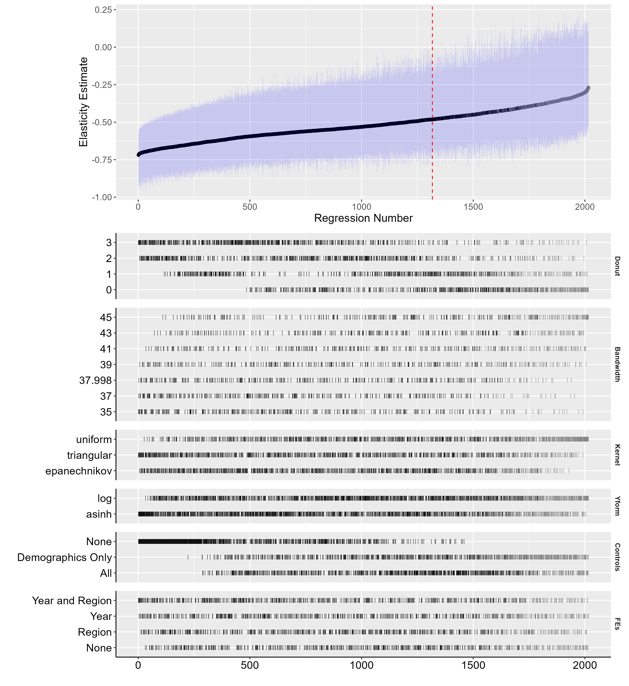
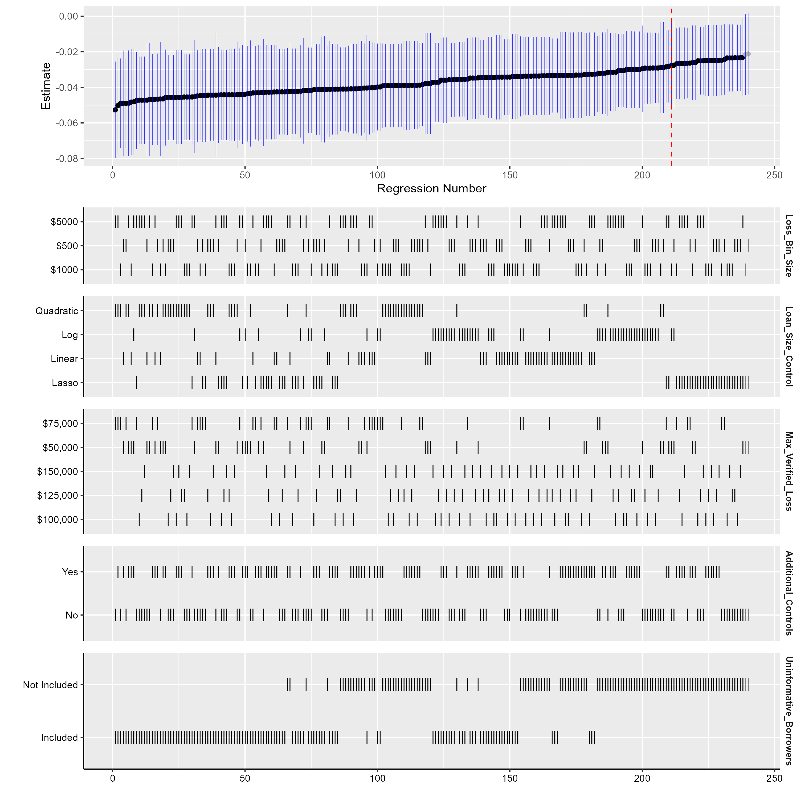
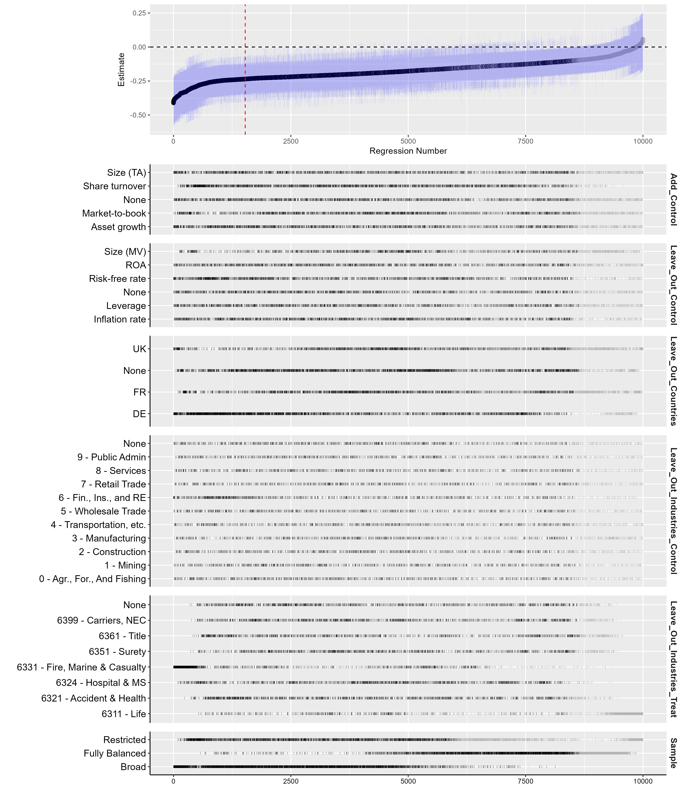

# Specification Curve Analysis in R

## Specification curves built with an AI assistant

This repository contains the code for *Specification Curves in Empirical Finance: A Practical Guide for AI-Assisted Research* (the manuscript itself is not distributed here). It is designed so that an AI coding assistant (Claude Code, Codex, Cursor, Copilot, ...) writes most of the code while the researcher makes the design decisions and the software enforces the rules that make the result trustworthy.

**Start here:** [`docs/ai-guide.md`](docs/ai-guide.md) is a runbook for researchers and their assistants, with ready-to-paste prompts in [`docs/prompts/`](docs/prompts/) and a drop-in instructions file in [`docs/templates/agent-instructions.md`](docs/templates/agent-instructions.md).

### How it works

1. The assistant writes a script that builds one analysis CSV and drafts a declarative `menu.json` ([schema](paper/config/menu.schema.json)): the base model, each decision with its options and justifications, excluded combinations, the published baseline with a tolerance, and the specifications the original article reported.
2. `validate` checks the menu against the data without estimating anything.
3. `freeze` writes the full grid with hashes of the data and analysis code. `estimate` refuses to run if any of them changed, keeps every specification (failures included), refuses to draw figures unless the published baseline reproduces, and records sample identities and counts.
4. A second implementation can be compared row by row with `tools/compare_implementations.py`.

| Language | Engine | Status |
|---|---|---|
| R (reference) | `paper/R/`, `paper/run.R` (fixest) | Tested; reference for both applications |
| Python | `python/speccurve/` (PyFixest) | Tested; agrees with R on all 602 application specifications |
| Stata | `stata/speccurve_run.do` (reghdfe), runs a plan exported by R | Provided; not yet run against R |

Supported estimators: linear models with any number of fixed effects (clustered, heteroskedasticity-robust, or i.i.d. errors; optional unit-specific linear trends) and means of a single time series such as a long-short portfolio return (i.i.d. or Newey-West errors). Joint specification-curve inference, multiway clustering, and nonlinear or heterogeneity-robust staggered-adoption estimators are not implemented; treat them as separate analyses.

### Commands

```sh
make setup        # install commit/push checks; check R dependencies
make restore      # restore the R packages recorded in renv.lock
make python-env   # create python/.venv with the Python port (requires uv)
make check        # publication policy, R workflow checks, Python tests
make demo         # synthetic-data demonstration (not an empirical result)

Rscript paper/run.R validate MENU.json INPUT.csv
Rscript paper/run.R freeze   MENU.json INPUT.csv MANIFEST.json
Rscript paper/run.R estimate MANIFEST.json INPUT.csv RUN_DIR
Rscript paper/run.R plan     MANIFEST.json INPUT.csv PLAN.csv     # for Stata
python -m speccurve run MENU.json INPUT.csv RUN_DIR
python3 tools/compare_implementations.py RUN_DIR/results.csv OTHER_RUN/results.csv
```

### The paper's applications

- [`paper/applications/bll2010`](paper/applications/bll2010/): Beck, Levine and Levkov (2010), bank branch deregulation and income inequality (324 specifications).
- [`paper/applications/cz_am`](paper/applications/cz_am/): the Fama and French (1992) assets-to-market anomaly using Chen and Zimmermann's open-source portfolios (20 specifications).
- [`paper/applications/cz_bliq`](paper/applications/cz_bliq/): the Pastor and Stambaugh (2003) liquidity beta, whose original construction is value-weighted (18 specifications).
- [`paper/applications/btmr2021`](paper/applications/btmr2021/): Bednarek, te Kaat, Ma and Rebucci (2021), whose authors call their Table 3 columns 7-8 the most conservative specifications (240 specifications).

Each folder documents where to download the public data (not redistributed here), the expected SHA-256 hashes, and the frozen menu. `sh paper/reproduce.sh RAW_DIR WORK_DIR` rebuilds the inputs, estimates the curves, cross-checks R against Python, and draws the figures and tables used in the paper.

R 4.5.1 with the packages in `renv.lock` and Python 3.11 with `python/pyproject.toml` were used. Data, generated outputs, and the manuscript stay outside version control: a deny-by-default `.gitignore` and commit/push checks allow only source code, menus, and documentation.

To preserve a public source document with provenance, use `paper/scripts/acquire_mitton_materials.py` (Python 3 and `curl`), which records URL, retrieval time, size, and SHA-256 and verifies cached files before reuse.

## Original customizable examples

This repository contains modifiable (not canned) code based on the R package `specr` to create extremely flexible and visually appealing specification curves in R. The files are also structured to create multiple spec curves across different dependent variables in an efficient manner and to allow sampling of specifications when there are many potential options. The code is designed to be intuitive and extremely customizable, allowing you to adapt it to any of your specific project needs. The repository includes two main files:

1. **Model Running File**: This file runs all the models. It requires significant customization based on your project, but it is structured in a way that makes it easy to adjust. AI coding models, such as Cursor, can assist in tailoring this file to your specific requirements. I find uploading your primary analysis file and then a list of the specifications you want to try gets you 90% of the way there. The included sample file lists options from Ellis, Takefumi, and Veith (2024).

2. **Curve Printing File**: This file takes the outcomes from the model running file and prints the specification curves. It includes markers ("#### MANUAL CHANGE REQUIRED ####") to indicate where manual adjustments are necessary. AI coding models, such as Cursor, will also assist here and can typically one-shot this file when you also upload the model running file. The included sample file lists options from Ellis, Takefumi, and Veith (2024) and will also create a Latex table summarizing all curves that are run.

## Sample Output Figures

Below are some sample output figures generated by the code:


Figure 1: Ellis, Cameron and Esson, Meghan and Liebman, Eli, Moral Hazard on the ACA Exchanges: Evidence from a Cost-Sharing Subsidy Discontinuity (July 12, 2024). Available at SSRN: https://ssrn.com/abstract=4892925 


Figure 2: Example from Collier, Benjamin and Ellis, Cameron and Keys, Benjamin J., The Cost of Consumer Collateral: Evidence from Bunching (January 1, 2022).  Available at SSRN: https://ssrn.com/abstract=4048069 


Figure 3: Example from Ellis, Cameron and Ueno, Takefumi and Veith, Stefan, The Solvency II Framework: Causal Effects on Risk and Liquidity (August 29, 2024). Available at SSRN: https://ssrn.com/abstract=4940529 

See the above referenced papers for sample language you can use to describe these figures.

## Citations

Please cite the following if you use this code in your research:

- Simonsohn, U., Simmons, J.P. & Nelson, L.D. (2020). Specification curve analysis. Nature Human Behaviour, 4, 1208–1214. https://doi.org/10.1038/s41562-020-0912-z
- Masur, Philipp K. & Scharkow, M. (2020). specr: Conducting and Visualizing Specification Curve Analyses. Available from https://CRAN.R-project.org/package=specr.
- Ellis, C. (2024). Customizable Specification Curves in R [Computer software]. https://github.com/cellis212/Customizable-Spec-Curves-R

## Getting Started

To get started with this code, follow these steps:

1. **Clone the Repository**: Clone this repository to your local machine using `git clone` or download the .zip. 
2. **Install Required Packages**: Ensure that you have the necessary R packages installed. The required packages are loaded at the top of each script.
3. **Customize the Model Running File**: Adjust the model running file to fit your specific project needs. This includes defining your data, model specifications, subsets, etc. You can also define separate outputs (i.e. generate an elasticity, etc.).
4. **Run the Model Running File**: Execute the model running file to generate the model outcomes. This will naturally run in parallel.
5. **Customize the Curve Printing File**: Make any necessary manual adjustments to the curve printing file as indicated by the markers.
6. **Generate Specification Curves**: Run the curve printing file to generate and save the specification curves.

## License

This project is licensed under the MIT License - see the [LICENSE](LICENSE) file for details.

